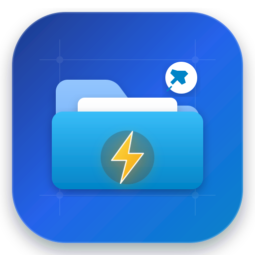

<p align="center">
  
</p>

<h1 align="center">Quick File Picker</h1>

<p align="center">
  <strong>Transform your Android System File Picker with instant virtual folder shortcuts, 3rd-party file manager integration, and smart sorting.</strong>
</p>

<p align="center">
  <a href="#-download--releases"></a>
  <a href="https://github.com"></a>
  <a href="LICENSE"></a>
  
  
</p>

---

## 💡 The Problem

Whenever you upload or attach a file inside apps like **ChatGPT, Gemini, Chrome, Firefox, WhatsApp, Telegram, Gmail, Google Drive, Slack, or Microsoft Edge**, Android summons the default system file picker (**DocumentsUI** / Storage Access Framework).

Every single time, you are forced to:
1. Tap the hamburger drawer ☰.
2. Tap "Internal Storage".
3. Scroll through dozens of directories.
4. Drill down deep into nested paths like `Android/media/com.whatsapp/WhatsApp/Media/WhatsApp Documents` or `Download/Invoices/2026`.
5. Repeat this cumbersome process on every file upload!

Additionally, the default system picker often sorts files arbitrarily and won't let you directly launch your favorite full-featured file manager (like **MiXplorer, Solid Explorer, or Cx File Explorer**).

---

## ⚡ The Solution: Quick File Picker

**Quick File Picker** hooks cleanly into Android's native **Storage Access Framework (SAF)** as an independent `DocumentsProvider`. It injects custom, user-defined directories directly into the system file picker's **"Open from"** sidebar!

When uploading files, your favorite directories appear as **top-level roots**. Tap one, and you are immediately inside that folder—no scrolling, no path navigation, zero wasted time.

<p align="center">
  
  <em>One tap to open any deep storage folder directly in the system file picker.</em>
</p>

---

## 🚀 Key Features

### 📁 Direct SAF Virtual Roots
- Exposes selected directories as top-level independent roots in `queryRoots()`.
- Seamlessly accessible across **any** app utilizing `ACTION_OPEN_DOCUMENT`, `ACTION_GET_CONTENT`, or `ACTION_OPEN_DOCUMENT_TREE`.
- Granted permissions persist indefinitely across reboots via Android's persistable URI grants.

### 📱 Direct 3rd-Party File Manager Launch
- Launch your favorite file explorer directly from the system picker's drawer!
- Supported one-tap integrations:
  - **MiXplorer / MiXplorer Silver**
  - **Solid Explorer**
  - **Cx File Explorer**
  - **Files by Google**
  - **ZArchiver**
  - **Total Commander**
  - **X-plore File Manager**
  - **FX File Explorer & Material Files**
  - *Custom package names supported via manual entry!*
- Launches instantly via an overlay proxy or notification bridge so you can pick files with your preferred app.

### ⚡ "Force Newest First" Smart Sorting
The Android system file picker is notorious for forcing alphabetical file order in certain applications. Quick File Picker provides breakthrough virtual sort engines:
- **`01, 02...` Numerical Prefix**: Prepends virtual index numbers so the newest modified files always stay pinned to the very top.
- **`[YYYY-MM-DD]` Date Prefix**: Prepends clean timestamp tags for chronological clarity.
- **Custom Sort Criteria**: Sort by Date (Newest/Oldest), Name (A–Z/Z–A), Size (Largest/Smallest), or File Extension.
- **Per-Shortcut Granularity**: Set custom sort modes per folder or inherit the global default.

### 📂 Nested Virtual Sub-Shortcuts (Hierarchical Organization)
- Avoid drawer clutter: nest secondary shortcuts inside a primary directory.
- Open a primary root in the file picker, and your configured sub-folders appear right at the top for immediate access.
- Easily move, reassign, or promote sub-shortcuts to primary roots.

### 🖼️ High-Fidelity Thumbnail Previews
- **PDF Previews**: Integrated native `PdfRenderer` generates real-time, crisp page-1 thumbnails for PDF documents directly in the picker grid!
- **Image & Video Thumbnails**: Fast, cached thumbnail rendering for images, videos, and media files.

### 🤖 Automatic Folders & Smart Collections
- **Auto-Folders**: Automatically detects and exposes high-volume storage directories:
  - 📥 *Downloads*
  - 💬 *Telegram & WhatsApp Documents*
  - 📷 *Camera & Screenshots (DCIM)*
  - 📄 *Documents*
- **Smart Collections**: Dedicated virtual aggregation roots:
  - 🖼️ *All Images* (`image/*`)
  - 🎬 *All Videos* (`video/*`)
  - 🎵 *All Audio* (`audio/*`)
  - 📑 *All PDFs* (`application/pdf`)
  - 📦 *All APKs* (`application/vnd.android.package-archive`)
  - 📝 *All Documents* (`doc`, `docx`, `pdf`, `txt`, `xls`, `ppt`)

### 🕒 Recent Files & Recent Folders
- Quick access to recently modified or opened files across your configured roots.
- Configurable recent items limit (e.g. 50 to 500 files).

### 🎨 Icon Customization & Drag-and-Drop Reordering
- Choose from 12+ vibrant Material symbols for instant visual identification (*Camera, Download, Telegram, WhatsApp, Medical, PDF, APK, Rocket, Star, Pin, Music, Video, Folder*).
- Interactive drag-and-drop handles in the app let you reorder roots—changes are immediately reflected in the system drawer.
- **Pin to Top** (`📌`) and **Favorites** (`⭐`) for high-priority workflows.

### 💾 JSON Backup & Restore
- Export your entire shortcut setup, sub-folders, and preferences to a clean `.json` file.
- Restore with a single tap on new devices, after a ROM flash, or when setting up work profiles.

### 🌙 True AMOLED Black & Dark Themes
- Choose between **System Default**, **Light**, **Dark**, and pure **AMOLED Dark (Pure Black #000000)** for OLED battery savings.

### 🛡️ 100% Offline & Private (Zero Root Required)
- **Zero Root / ADB Required**: 100% compliant with Android's official Storage Access Framework standards.
- **No Internet Permission**: The app does **NOT** declare `android.permission.INTERNET`. Your files, file paths, and storage contents never touch the cloud or any remote server.

---

## 📥 Download & Releases

Pre-built APKs are available on the **[Releases](https://github.com)** tab:

| Release Package | Target | Description |
|---|---|---|
| **`Quick File Picker.apk`** | Production | Stable, universal APK ready to install on any device (Android 7.0+) |
| **`Quick File Picker-debug.apk`** | Debug | Debug build with extra diagnostic logs for developers |

### Installation Instructions
1. Download **`Quick File Picker.apk`** from the latest release.
2. Tap the downloaded APK to install.
3. If prompted, allow your browser or file manager permission to *"Install unknown apps"*.
4. Open **Quick File Picker** and start adding your folders!

---

## 📖 How It Works

```
┌─────────────────────────────────────────────────────────┐
│                 Target App (e.g., ChatGPT)              │
│               User taps "Upload Document"               │
└────────────────────────────┬────────────────────────────┘
                             │ Launches ACTION_OPEN_DOCUMENT
                             ▼
┌─────────────────────────────────────────────────────────┐
│           Android System File Picker (DocumentsUI)       │
│                                                         │
│   "Open from" Drawer:                                   │
│   ├── 📱 Internal Storage                               │
│   ├── ☁️ Google Drive                                   │
│   ├── 📂 FCPS Research            ◄── [Quick File Picker]  │
│   ├── ✈️ Telegram Downloads        ◄── [Quick File Picker]  │
│   ├── 📑 Invoices & Taxes         ◄── [Quick File Picker]  │
│   └── 📱 MiXplorer Launcher       ◄── [Quick File Picker]  │
└────────────────────────────┬────────────────────────────┘
                             │ User selects "FCPS Research"
                             ▼
┌─────────────────────────────────────────────────────────┐
│           Directly inside target folder!                │
│    Files displayed with real-time PDF/image previews    │
│         and "Force Newest First" chronological order    │
└─────────────────────────────────────────────────────────┘
```

1. **Open Quick File Picker** and tap **"+ Add Shortcut"**.
2. Select **Folder Shortcut** to pick any folder using Android's directory picker, or select **3rd-Party App Shortcut** to connect a file manager.
3. Choose a custom label, icon, and sort mode, then hit **Save**.
4. Switch to any app that requests a file upload. Open the sidebar drawer and tap your shortcut!

---

## 🛠️ Architecture & Tech Stack

Quick File Picker is engineered following modern Android architecture principles:

- **Language**: Kotlin 100%
- **System Integration**: Custom `DocumentsProvider` (`com.quickfilepicker.documents`)
- **Persistence**: Room Database (`AppDatabase`, `ShortcutDao`, `RecentFolderDao`, `FavoriteItemDao`)
- **Architecture**: MVVM (Model-View-ViewModel) + Repository Pattern + Coroutines/StateFlow
- **UI Framework**: Material Design 3, ViewBinding, RecyclerView with `ItemTouchHelper`
- **Thumbnail Engine**: Android `PdfRenderer` + `MediaMetadataRetriever` + `BitmapFactory`
- **Compatibility**: Android 7.0 (API 24) through Android 16 (API 36)

---

## 🔒 Permissions & Security Transparency

Quick File Picker values your privacy above all else:

| Permission | Purpose |
|---|---|
| `MANAGE_DOCUMENTS` | Mandatory Android system contract to implement a `DocumentsProvider`. |
| `SYSTEM_ALERT_WINDOW` *(Optional)* | Used exclusively to launch 3rd-party file managers directly when selected in the picker drawer. |
| `POST_NOTIFICATIONS` *(Optional)* | Fallback proxy to open external apps on devices restricting background activity launches. |
| `QUERY_ALL_PACKAGES` | Allows you to select installed file managers (MiXplorer, Solid Explorer, etc.) as picker shortcuts. |
| **`INTERNET`** | ❌ **NOT REQUESTED**. The app has zero network capability. |

---

## 🤝 Contributing

Contributions, feature suggestions, and bug reports are welcome!
1. Fork the Project.
2. Create your Feature Branch (`git checkout -b feature/AmazingFeature`).
3. Commit your Changes (`git commit -m 'Add some AmazingFeature'`).
4. Push to the Branch (`git push origin feature/AmazingFeature`).
5. Open a Pull Request.

---

## 📄 License

Distributed under the **Apache License 2.0**. See [`LICENSE`](LICENSE) for more information.

<p align="center">
  Made with ❤️ for power users who demand faster Android workflows.
</p>
